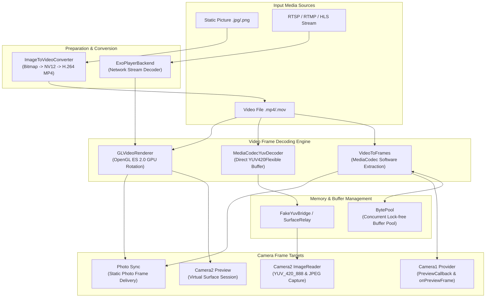
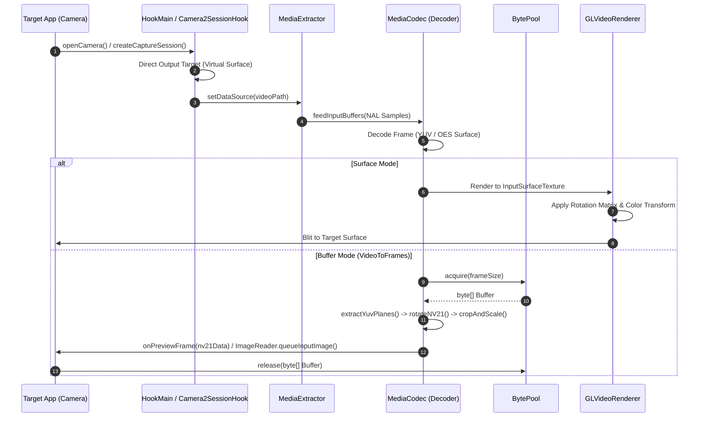
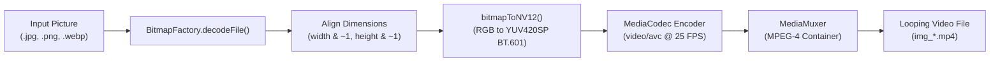

# FrameMirrorAndroid

> **A high-performance Android video frame pipeline and media processing framework for researching, studying, and experimenting with real-time video frames, color space conversions, and image-to-stream synthesis.**

[-brightgreen.svg)](#requirements)
[](#tech-stack)
[](#tech-stack)
[](#architecture)
[](LICENSE)

---

## Table of Contents

- [Overview](#overview)
- [Why Use This Project for Study & Practice?](#why-use-this-project-for-study--practice)
- [Core Concepts & Theory](#core-concepts--theory)
  - [1. Color Spaces: YUV, NV21, NV12, and RGB](#1-color-spaces-yuv-nv21-nv12-and-rgb)
  - [2. Stride, Row Pitch, and Byte Alignment](#2-stride-row-pitch-and-byte-alignment)
  - [3. Hardware Decoding vs. Software Extraction](#3-hardware-decoding-vs-software-extraction)
  - [4. OpenGL ES GPU Texture Shaders](#4-opengl-es-gpu-texture-shaders)
- [Architecture & Pipelines](#architecture--pipelines)
  - [High-Level System Flow](#high-level-system-flow)
  - [Video Frame Pipeline (Demuxing to Ingestion)](#video-frame-pipeline-demuxing-to-ingestion)
  - [Picture-to-Video Encoding Pipeline](#picture-to-video-encoding-pipeline)
  - [Camera1 & Camera2 Frame Pipeline Mechanisms](#camera1--camera2-frame-pipeline-mechanisms)
- [Codebase Study Map](#codebase-study-map)
- [Hands-on Practice & Laboratory Experiments](#hands-on-practice--laboratory-experiments)
  - [Lab 1: Inspecting YUV Plane Strides & Padding](#lab-1-inspecting-yuv-plane-strides--padding)
  - [Lab 2: Practicing NV21 In-Memory Rotation](#lab-2-practicing-nv21-in-memory-rotation)
  - [Lab 3: Implementing Bilinear Scaling for YUV](#lab-3-implementing-bilinear-scaling-for-yuv)
  - [Lab 4: Converting Still Pictures to H.264 Video](#lab-4-converting-still-pictures-to-h264-video)
  - [Lab 5: Synchronizing Frame Capture with Photo Sync](#lab-5-synchronizing-frame-capture-with-photo-sync)
  - [Lab 6: GPU Shader Matrix Transformations](#lab-6-gpu-shader-matrix-transformations)
- [Getting Started & Build Instructions](#getting-started--build-instructions)
  - [Prerequisites](#prerequisites)
  - [Building from Source](#building-from-source)
  - [Installation & Activation](#installation--activation)
- [Media Management & Configuration](#media-management--configuration)
  - [Storage Layout](#storage-layout)
  - [Config Options (`cs_config.json`)](#config-options-cs_configjson)
- [License & Disclaimer](#license--disclaimer)

---

## Overview

**FrameMirrorAndroid** (historically named *FrameMirror* / *VCAM*) is an open-source research and engineering framework for Android designed to study camera pipelines, image processing, and custom video stream delivery (local files, RTSP/RTMP/HLS/DASH network streams, and static images).

Built on top of Android's modern **MediaCodec** hardware pipeline and **OpenGL ES 2.0**, this codebase serves as a comprehensive reference implementation for learning how modern mobile OS camera frameworks manipulate raw frames behind the scenes.

---

## Why Use This Project for Study & Practice?

Working with camera hardware and video streams on Android can be challenging due to vendor-specific driver quirks, proprietary buffer allocations, and complex threading models. This repository offers a clean sandbox for practicing:

- **Frame-by-Frame Decoding**: Demux containers (`.mp4`, `.mkv`, `.mov`) with `MediaExtractor` and feed H.264 NAL units into `MediaCodec`.
- **YUV Buffer Forensics**: Unpack planar/semi-planar `YUV_420_888` planes, inspect row strides, pixel strides, and format alignments across devices.
- **Color Space Conversions**: Convert between ARGB/RGB and YUV (NV12/NV21) using BT.601 matrices in software or via GPU shaders.
- **Hardware Encoding**: Programmatic H.264 encoding with `MediaCodec` + `MediaMuxer` to synthesize video streams from single pictures.
- **GPU Texture Pipelines**: Zero-copy video playback onto `SurfaceTexture` / `Surface` with OpenGL ES 2.0 matrices (`GL_TEXTURE_EXTERNAL_OES`) for real-time rotation and aspect-ratio compensation.
- **Android Camera Architecture**: Hooking and routing data through legacy `Camera1` preview callbacks, `Camera2` `CaptureRequest.Builder`, `ImageReader`, `ImageWriter`, and `OutputConfiguration`.
- **Memory & Allocation Tuning**: High-frequency frame allocation optimization using reusable object pools (`BytePool`).

---

## Core Concepts & Theory

### 1. Color Spaces: YUV, NV21, NV12, and RGB

Video decoding hardware on Android emits raw frames in YUV color space rather than RGB. YUV separates brightness (Luma, **Y**) from color (Chroma, **U/Cb** and **V/Cr**), exploiting the human eye's lower sensitivity to color detail through **4:2:0 subsampling** (chroma resolution is halved in both width and height).

| Format | Representation | Memory Size (per pixel) | Android Constant |
| :--- | :--- | :--- | :--- |
| **RGB_8888** | Interleaved R, G, B, A (32-bit) | 4 bytes | `Bitmap.Config.ARGB_8888` |
| **I420 (YUV420P)** | Planar: all Y, followed by all U, followed by all V | 1.5 bytes ($12 \text{ bits}$) | `COLOR_FormatYUV420Planar` |
| **NV21 (YUV420SP)** | Semi-Planar: all Y, followed by interleaved V, U, V, U... | 1.5 bytes ($12 \text{ bits}$) | `ImageFormat.NV21` (Camera1 standard) |
| **NV12** | Semi-Planar: all Y, followed by interleaved U, V, U, V... | 1.5 bytes ($12 \text{ bits}$) | `COLOR_FormatYUV420SemiPlanar` (Codec standard) |
| **YUV_420_888** | Generic container representing I420, NV12, or NV21 | 1.5 bytes ($12 \text{ bits}$) | `ImageFormat.YUV_420_888` (Camera2 standard) |

#### Mathematical Conversion (ITU-R BT.601)
To convert RGB into YUV:
$$Y = ((66 \cdot R + 129 \cdot G + 25 \cdot B + 128) \gg 8) + 16$$
$$U = ((-38 \cdot R - 74 \cdot G + 112 \cdot B + 128) \gg 8) + 128$$
$$V = ((112 \cdot R - 94 \cdot G - 18 \cdot B + 128) \gg 8) + 128$$

---

### 2. Stride, Row Pitch, and Byte Alignment

In memory, a frame of width $W$ might not simply consume $W$ contiguous bytes per line. Hardware decoders and GPU drivers align memory rows to multiples of 16, 32, or 64 bytes for memory bus efficiency:

```
+------------------------------------------+---------------+
| Active Luma Pixels (Width = 1920 bytes)  | Padding (128B)| -> RowStride = 2048 bytes
+------------------------------------------+---------------+
```

When extracting frames from `android.media.Image`, failing to account for `rowStride` and `pixelStride` produces slanted, warped, or green-tinted video artifacts.

---

### 3. Hardware Decoding vs. Software Extraction

FrameMirrorAndroid implements two complementary video frame pipelines:

1. **Direct Surface Route (Zero-Copy)**: `MediaCodec` or `MediaPlayer` renders directly to a Surface backed by an OpenGL `SurfaceTexture`. Zero memory copies occur on the CPU.
2. **Buffer/Memory Route (Analysis Mode)**: `MediaCodec` outputs `COLOR_FormatYUV420Flexible`, exposing raw `Image.Plane[]` buffers. Frames can be rotated, cropped, inspected, or converted in user space before reaching downstream consumers.

---

### 4. OpenGL ES GPU Texture Shaders

To rotate frames without CPU bottlenecks, an offscreen OpenGL ES pipeline uses an external sampler:

```glsl
// Fragment Shader
#extension GL_OES_EGL_image_external : require
precision mediump float;
varying vec2 vTextureCoord;
uniform samplerExternalOES sTexture;

void main() {
    gl_FragColor = texture2D(sTexture, vTextureCoord);
}
```

Rotation and scaling are applied in the vertex shader using standard 4x4 affine matrices ($M_{rotation} \times M_{surface\_texture}$).

---

## Architecture & Pipelines

### High-Level System Flow



---

### Video Frame Pipeline (Demuxing to Ingestion)

The extraction and delivery cycle is detailed below:



---

### Picture-to-Video Encoding Pipeline

When practicing with still pictures, `ImageToVideoConverter.java` provides an end-to-end tutorial on encoding still images into standard video streams:



1. **Alignment**: MediaCodec H.264 encoders require dimensions divisible by 2 (macroblock boundary).
2. **NV12 Synthesis**: Scans pixels, computes Y, U, and V channels, and interleaves U/V for semi-planar hardware encoding.
3. **PTS Synthesis**: Calculates synthetic Presentation Time Stamps ($PTS = \frac{frameIndex \times 1,000,000}{FPS}$) across 3-second loops.
4. **Muxing**: Writes codec-config buffers (SPS/PPS) followed by synchronized video tracks into an `.mp4` file.

---

### Camera1 & Camera2 Frame Pipeline Mechanisms

The framework handles differences between camera subsystem generations:

#### Camera1 Delivery (`Camera1Handler.java`)
- **Preview Display**: Connects `setPreviewTexture` or `setPreviewDisplay` to a custom `SurfaceTexture`.
- **Preview Callback**: Handles `onPreviewFrame(byte[] data, Camera camera)`:
  - Connects registered callbacks (`setPreviewCallback`, `setOneShotPreviewCallback`, `setPreviewCallbackWithBuffer`).
  - Supplies decoded NV21 frames from `VideoToFrames` inside `data`.
- **Photo Capture**: Intercepts `takePicture`:
  - Captures current frame from `GLVideoRenderer` via `glReadPixels`, or extracts frame matching the current video timestamp using `MediaMetadataRetriever`.
  - Compresses to JPEG and delivers directly to `PictureCallback.onPictureTaken`.

#### Camera2 Delivery (`Camera2Handler.java` & `Camera2SessionHook.java`)
- **Session Routing**: Routes `CameraDevice.createCaptureSession()` to deliver test frames to virtual surfaces.
- **ImageReader & YUV Bridge (`FakeYuvBridge`)**: If the target application consumes frames via `ImageReader` (e.g., computer vision pipelines or messaging apps):
  - Supplies hardware-decoded `YUV_420_888` or NV21 frames directly to the target surface using Android's `ImageWriter`.
- **Photo Sync**: Detects JPEG capture requests in `CaptureRequest.Builder.addTarget()`, captures matching high-res frames, and delivers them as the photo result.

---

## Codebase Study Map

| File / Component | Primary Responsibility | Key Educational Concepts |
| :--- | :--- | :--- |
| [`VideoToFrames.java`](file:///Users/truong/Documents/projects/FrameMirrorAndroid/app/src/main/java/com/framemirror/android/VideoToFrames.java) | Software extraction & processing of video frames | `MediaExtractor`, `MediaCodec`, YUV plane extraction, stride compensation, `rotateNV21`, `cropAndScaleNV21` |
| [`MediaCodecYuvDecoder.java`](file:///Users/truong/Documents/projects/FrameMirrorAndroid/app/src/main/java/com/framemirror/android/MediaCodecYuvDecoder.java) | Direct lock-free YUV frame extraction | `COLOR_FormatYUV420Flexible`, volatile double-buffering, PTS pacing, plane stride unrolling |
| [`ImageToVideoConverter.java`](file:///Users/truong/Documents/projects/FrameMirrorAndroid/app/src/main/java/com/framemirror/android/utils/ImageToVideoConverter.java) | Still picture to looping MP4 synthesizer | `Bitmap` to `NV12`, BT.601 math, `MediaCodec` encoding, `MediaMuxer` MP4 track assembly |
| [`ImageUtils.java`](file:///Users/truong/Documents/projects/FrameMirrorAndroid/app/src/main/java/com/framemirror/android/utils/ImageUtils.java) | Direct picture color conversion helpers | RGB-to-YCbCr420 direct byte array bitwise operations |
| [`GLVideoRenderer.java`](file:///Users/truong/Documents/projects/FrameMirrorAndroid/app/src/main/java/com/framemirror/android/GLVideoRenderer.java) | EGL context & OpenGL ES 2.0 rotation renderer | EGL display/surface setup, OES external textures, vertex/fragment shaders, `glReadPixels` frame capture |
| [`BytePool.java`](file:///Users/truong/Documents/projects/FrameMirrorAndroid/app/src/main/java/com/framemirror/android/BytePool.java) | High-performance lock-free byte buffer pool | Allocation pooling, GC pressure reduction, `ConcurrentLinkedDeque` |
| [`Camera1Handler.java`](file:///Users/truong/Documents/projects/FrameMirrorAndroid/app/src/main/java/com/framemirror/android/Camera1Handler.java) | Camera1 API routing and buffer handling | `onPreviewFrame` handling, `takePicture` frame synthesis |
| [`Camera2SessionHook.java`](file:///Users/truong/Documents/projects/FrameMirrorAndroid/app/src/main/java/com/framemirror/android/Camera2SessionHook.java) | Camera2 session routing and multi-target delivery | `CameraCaptureSession`, `ImageWriter`, `ImageReader`, YUV bridge |
| [`LineElsaHandler.java`](file:///Users/truong/Documents/projects/FrameMirrorAndroid/app/src/main/java/com/framemirror/android/LineElsaHandler.java) | Specialized AR & ML engine camera adapter | Adapting proprietary graphics pipelines while preserving filters and facial stickers |

---

## Hands-on Practice & Laboratory Experiments

### Lab 1: Inspecting YUV Plane Strides & Padding
**Goal:** Understand why `image.getWidth() != plane.getRowStride()`.

Open [`VideoToFrames.java`](file:///Users/truong/Documents/projects/FrameMirrorAndroid/app/src/main/java/com/framemirror/android/VideoToFrames.java) around `getDataFromImage`:
```java
Rect crop = image.getCropRect();
int width = crop.width();
int height = crop.height();
Image.Plane[] planes = image.getPlanes();

int yRowStride = planes[0].getRowStride();
int yPixelStride = planes[0].getPixelStride();
LogUtil.log("Frame: " + width + "x" + height + " | RowStride: " + yRowStride + " | PixelStride: " + yPixelStride);
```
**Exercise:**
1. Feed a non-standard resolution video (e.g., $1080 \times 2340$ or $720 \times 1560$) into the app.
2. Observe logcat outputs. Notice how many bytes of padding are added at the end of each row.
3. Remove the row stride offset handling (`buffer.position(...)`) and observe the diagonal shearing on the target screen.

---

### Lab 2: Practicing NV21 In-Memory Rotation
**Goal:** Master 2D matrix transformation on flattened byte arrays.

In [`VideoToFrames.java`](file:///Users/truong/Documents/projects/FrameMirrorAndroid/app/src/main/java/com/framemirror/android/VideoToFrames.java#L565), study the `rotateNV21` method:
- **90° Clockwise Rotation for Y Plane**:
  The pixel at coordinate $(x, y)$ moves to $(H - 1 - y, x)$ in the rotated frame of dimensions $(H, W)$:
  ```java
  for (int x = 0; x < width; x++) {
      for (int y = height - 1; y >= 0; y--) {
          output[k++] = input[y * width + x];
      }
  }
  ```
- **90° Rotation for UV Plane**:
  Recall that UV values are 2-byte pairs ($V, U$) subsampled every $2 \times 2$ block:
  ```java
  for (int x = 0; x < width; x += 2) {
      for (int y = height / 2 - 1; y >= 0; y--) {
          output[k++] = input[frameSize + y * width + x];     // V
          output[k++] = input[frameSize + y * width + x + 1]; // U
      }
  }
  ```
**Exercise:**
Implement horizontal mirroring (flip) on NV21 data for front-facing camera emulation.

---

### Lab 3: Implementing Bilinear Scaling for YUV
**Goal:** Implement software resampling without OpenCV or external libraries.

Look at `cropAndScaleNV21()` in [`VideoToFrames.java`](file:///Users/truong/Documents/projects/FrameMirrorAndroid/app/src/main/java/com/framemirror/android/VideoToFrames.java#L467):
- Evaluates the four neighboring pixels ($p_{00}, p_{01}, p_{10}, p_{11}$) for target position $(s_x, s_y)$.
- Computes weighted interpolation for the Luma channel ($Y$):
  ```java
  float val = (p00 * dx1 + p01 * dx) * dy1 + (p10 * dx1 + p11 * dy) * dy;
  dst[dstRowOffset + x] = (byte) (int) val;
  ```
- Uses nearest-neighbor for the chroma UV plane to balance performance.

---

### Lab 4: Converting Still Pictures to H.264 Video
**Goal:** Create a looping video stream from a single image using hardware encoders.

Open [`ImageToVideoConverter.java`](file:///Users/truong/Documents/projects/FrameMirrorAndroid/app/src/main/java/com/framemirror/android/utils/ImageToVideoConverter.java):
1. **Decode & Scale**: Decode a high-resolution `.jpg` with `BitmapFactory`. Downscale to fit within $1920 \times 1920$ if needed.
2. **ARGB to NV12**: Run `bitmapToNV12()` to convert pixel colors.
3. **Queue Input Buffers**:
   ```java
   int inputBufIndex = encoder.dequeueInputBuffer(TIMEOUT_USEC);
   if (inputBufIndex >= 0) {
       ByteBuffer inputBuf = encoder.getInputBuffer(inputBufIndex);
       inputBuf.put(yuvData);
       encoder.queueInputBuffer(inputBufIndex, 0, yuvData.length, ptsUsec, 0);
   }
   ```
4. **Drain Output to Muxer**: Wait for `INFO_OUTPUT_FORMAT_CHANGED`, configure `MediaMuxer.addTrack()`, and write samples.

---

### Lab 5: Synchronizing Frame Capture with Photo Sync
**Goal:** Synchronize a photo capture event with the exact video frame currently being played.

Inspect `handlePhotoFake()` in [`Camera1Handler.java`](file:///Users/truong/Documents/projects/FrameMirrorAndroid/app/src/main/java/com/framemirror/android/Camera1Handler.java#L414):
1. Query `MediaPlayer.getCurrentPosition()`.
2. Initialize `MediaMetadataRetriever`:
   ```java
   retriever.setDataSource(videoPath);
   Bitmap frame = retriever.getFrameAtTime(
       currentPosMs * 1000L,
       MediaMetadataRetriever.OPTION_CLOSEST
   );
   ```
3. Alternatively, capture directly from the active GPU surface via `captureFrameFromGlRenderer()` using `glReadPixels()` for lower latency.
4. Compress to JPEG and return to the target application's callback.

---

### Lab 6: GPU Shader Matrix Transformations
**Goal:** Understand texture coordinates in Android OpenGL ES.

In [`GLVideoRenderer.java`](file:///Users/truong/Documents/projects/FrameMirrorAndroid/app/src/main/java/com/framemirror/android/GLVideoRenderer.java), Android's `SurfaceTexture.getTransformMatrix(float[] mtx)` automatically accounts for coordinate flips and video orientation metadata.
```java
// Combine SurfaceTexture transform with custom rotation
Matrix.setRotateM(mRotMatrix, 0, mRotationDegrees, 0, 0, 1.0f);
```
**Exercise:**
Modify the fragment shader in [`GLHelper.java`](file:///Users/truong/Documents/projects/FrameMirrorAndroid/app/src/main/java/com/framemirror/android/GLHelper.java) to apply real-time color filters (e.g., Grayscale, Sepia, or Thresholding) to the video stream.

---

## Getting Started & Build Instructions

### Prerequisites
- Android Studio Ladybug (2024.2+) or newer
- Android SDK Platform 36 (Android 16 Developer Preview / Android 15 SDK 35)
- Android NDK `25.1.8937393`
- CMake `3.22.1`
- An Android test device or emulator (Android 8.0 through Android 15/16)
- Standard module runtime environment supporting API 101

### Building from Source

1. **Clone the repository with submodules** (includes native hook library):
   ```bash
   git clone --recurse-submodules https://github.com/framemirror/FrameMirrorAndroid.git
   cd FrameMirrorAndroid
   ```
   *(If already cloned without `--recurse-submodules`, run `git submodule update --init --recursive`)*

2. **Assemble the debug APK**:
   ```bash
   ./gradlew assembleDebug
   ```

3. **Install the APK to your test device**:
   ```bash
   adb install -r app/build/outputs/apk/debug/app-arm64-v8a-debug.apk
   ```

### Installation & Activation

1. Open your module manager application.
2. Enable the **FrameMirror** module.
3. Select the target applications you want to study (e.g., Camera, Messenger, Line, WhatsApp, or custom test apps).
4. Restart the target application or system.

---

## Media Management & Configuration

### Storage Layout

All test videos, still pictures, audio tracks, and configuration settings are managed in:
```
/sdcard/DCIM/Camera1/
```

| File / Folder | Purpose |
| :--- | :--- |
| `Cam.mp4` / `virtual.mp4` | Default fallback video file |
| `*.mp4`, `*.mov`, `*.mkv`, `*.avi` | Video library files accessible in the Manage tab |
| `*.jpg`, `*.jpeg`, `*.png`, `*.bmp` | Still pictures (auto-converted to video via UI) |
| `Mic.mp3` | Audio track used for microphone replacement |
| `cs_config.json` | Active runtime configuration |
| `.nomedia` | Prevents test media from cluttering the Android System Gallery |

### Config Options (`cs_config.json`)

The module monitors `cs_config.json` in real time. Key flags include:

```json
{
  "disable_module": false,
  "selected_video": "test_pattern_1080p.mp4",
  "selected_image": "sample_card.png",
  "replace_mode": "video",
  "video_rotation_offset": 90,
  "enable_photo_fake": true,
  "play_video_sound": false,
  "enable_mic_hook": false,
  "mic_hook_mode": "video_sync",
  "media_source_type": "local",
  "stream_url": "rtsp://192.168.1.100:8554/live"
}
```

> [!TIP]
> You can also adjust rotation, switch videos, or pause playback in real time using the in-app **Floating Overlay Bubble** or the **Notification Bar Quick Controls**.

---

## License & Disclaimer

- **License**: This project is licensed under the [GNU General Public License v3.0](LICENSE).
- **Disclaimer**: This codebase is provided strictly for educational purposes, software research, performance benchmarking, and camera pipeline analysis. Users are solely responsible for compliance with local regulations and application terms of service.
